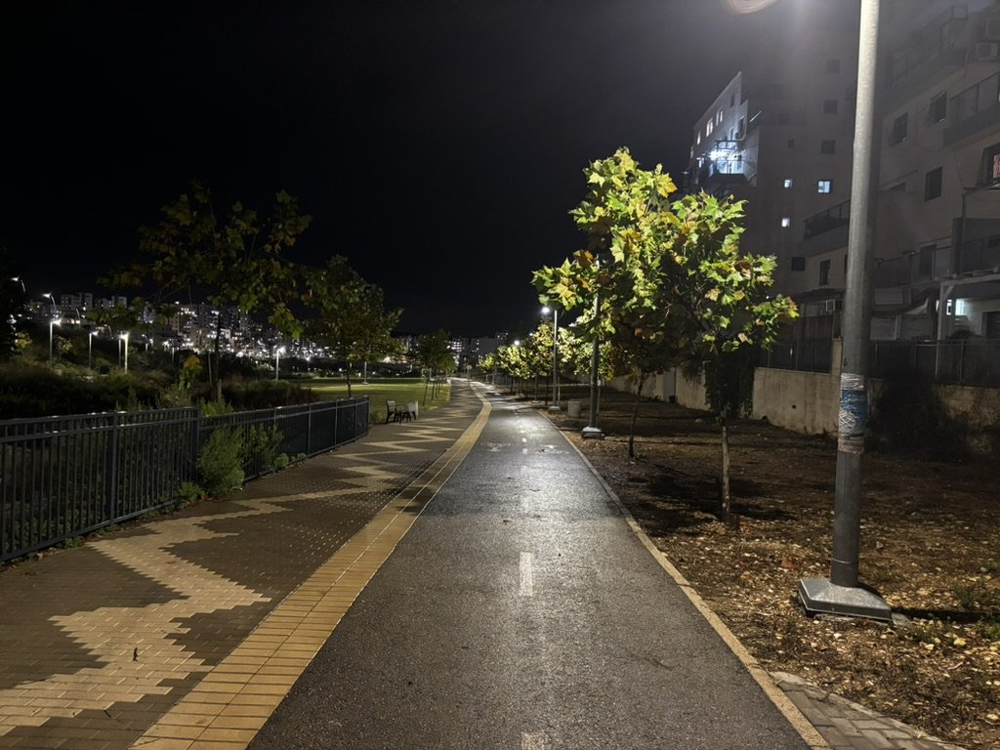
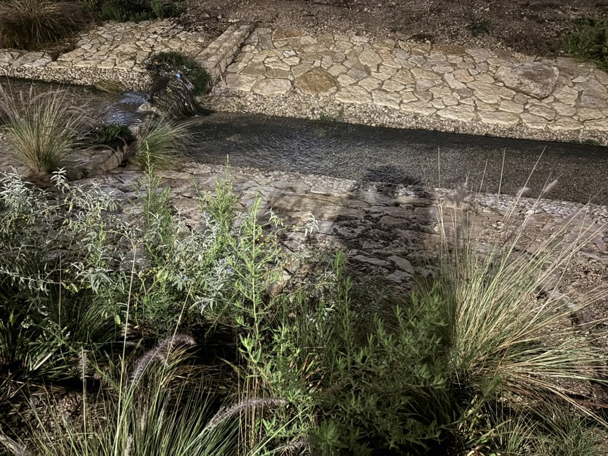
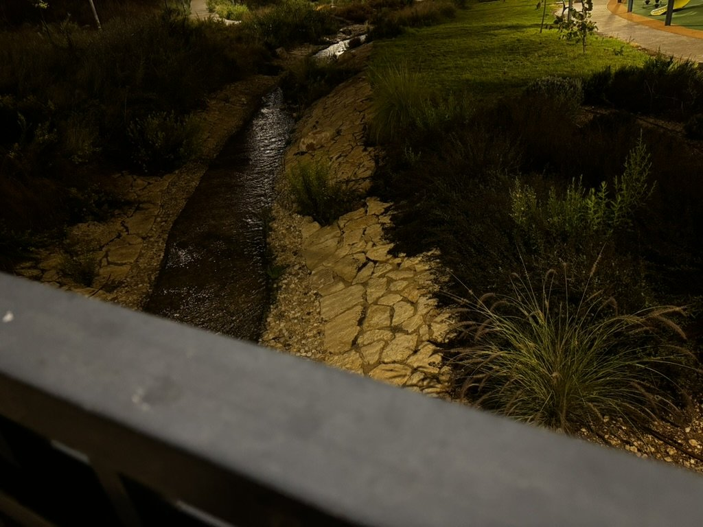
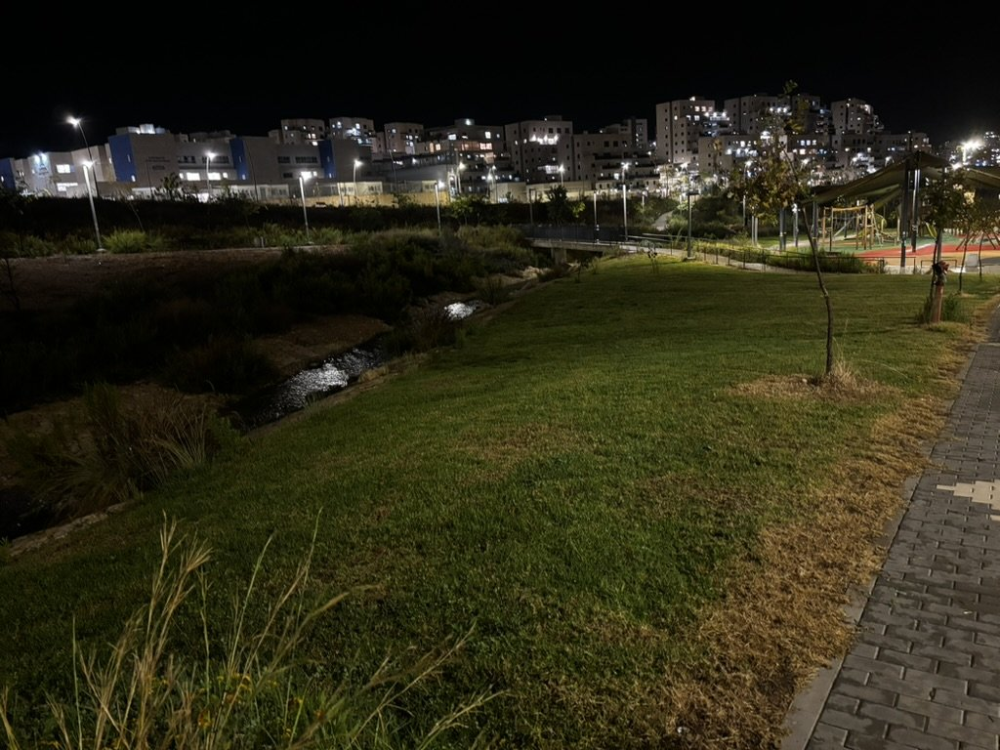
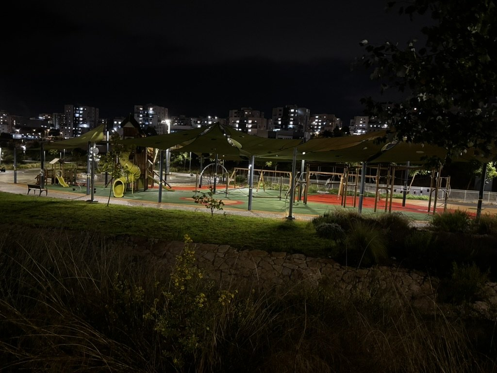
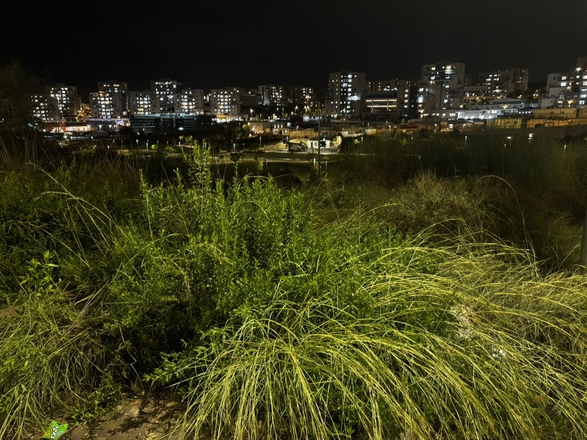
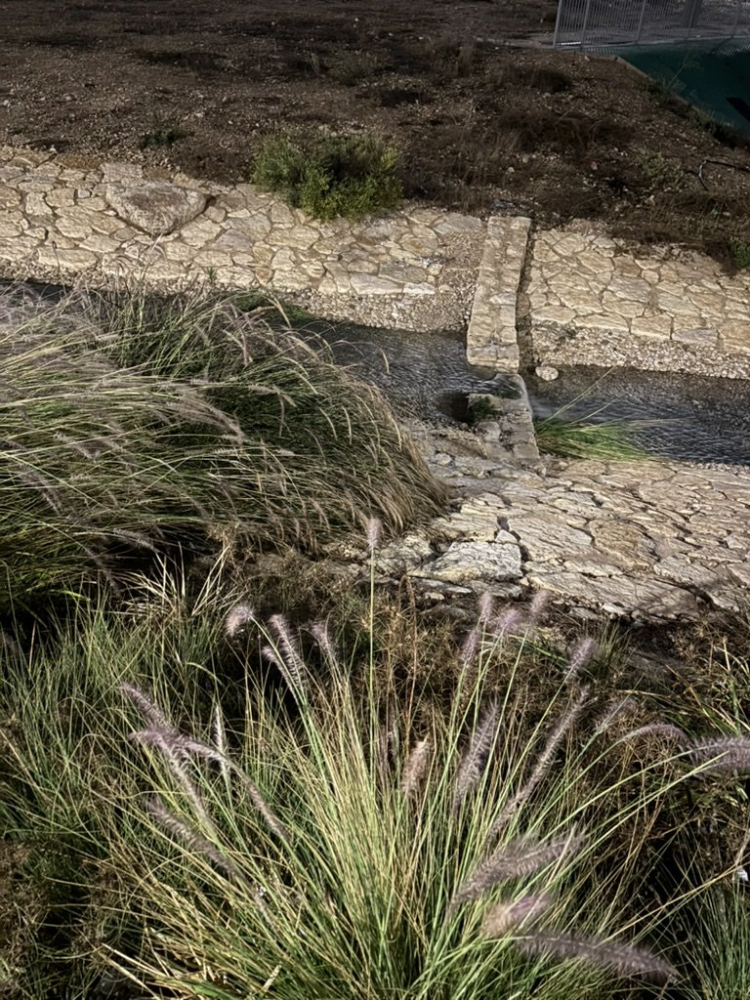
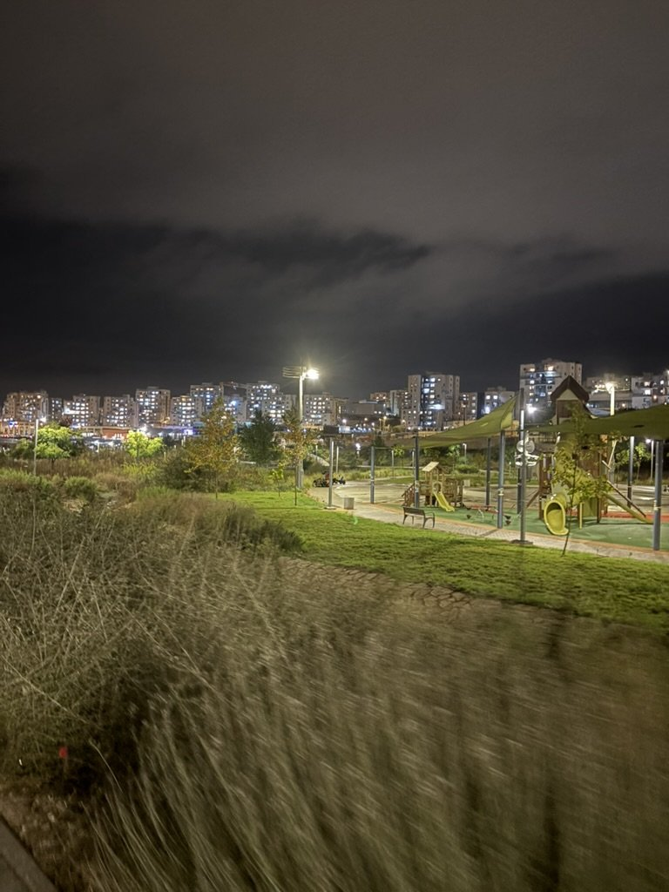

## خاطِرة

هلأ الجو بصير أبرد، وهيك أحلى.

لون الورق بتغيّر عالشجر.

وصلنا للخريف، وهو فصلي المفضّل بإسرائيل.

في حديقة ببيت شيمش، فيها جدول ميّ. بالصيف عادةً بكون ناشف، بس بالخريف بصير كتير حلو.





كل إشي بصير أحلى، كإنه سحر، لما يكون في لسعة برد بالجو.







## كلام

| Arabic         | IPA                        | Meaning                                                                    |
| -------------- | -------------------------- | -------------------------------------------------------------------------- |
| الجو بصير أبرد | /ij-ˈʒaww bˈsˤiːr ˈʔabrad/ | the weather's getting colder (بصير + comparative = «getting ‑er»)          |
| بتغيّر عالشجر  | /bitˈɣajjar ʕa-ʃ-ˈʃaʒar/   | changes on the trees (عال = «على ال»); ورق here is «leaves», not «paper» |
| بكون ناشف      | /bˈkuːn ˈnaːʃef/           | it's (usually) dry: بكون gives the habitual «is»                           |
| كإنه سحر       | /ˈkaʔinno ˈseħer/          | as if it's magic                                                           |
| لسعة برد       | /ˈlasʕit bard/             | a nip of cold in the air (literally «a sting of cold»)                     |

---

*I post something short here most days while learning Arabic. If this helped, you'll probably like the next one too.*

