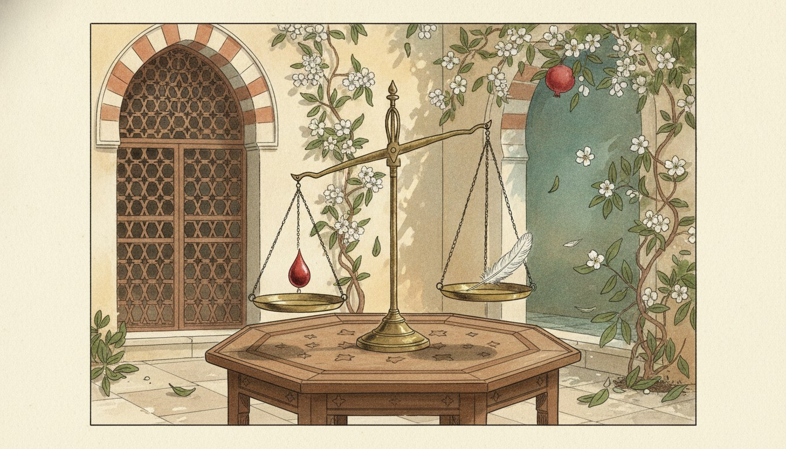
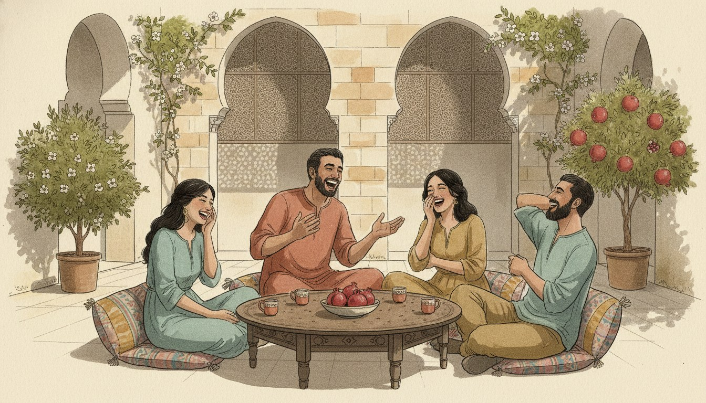
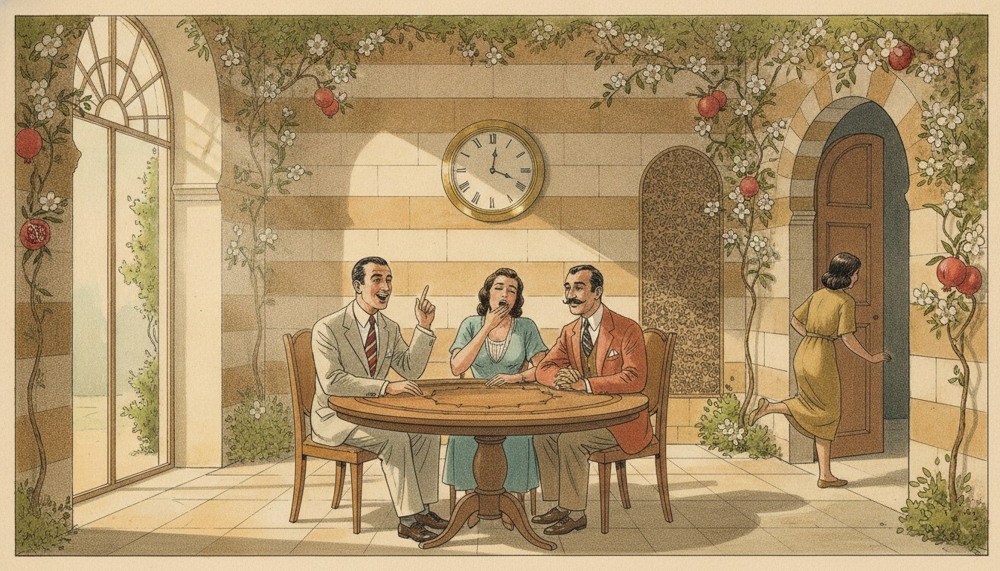

## خاطِرة

في تعبيرين شاميين بحبّهم كتير، وهنّي وجهين لعملة وحدة: «دمّه خفيف» و«دمّه تقيل».

حرفيًا، واحد دمّه خفيف وواحد دمّه تقيل. بس ما حدا عم يحكي عن فحص دم!

لما بنقول عن حدا «دمّه خفيف»، يعني هو بيضحّك، وبتنبسط تقعد معه. بيحكي كلمتين، وبتلاقي حالك عم تضحك.



وإذا «دمّه تقيل»؟ يعني صعب تقعد معه. لأنه مش كل واحد بيحكي نكت دمّه خفيف. في ناس بيعيدوا نفس النكتة عشر مرات… وبالمرة العاشرة، بدّك تروح عالبيت. 😅



وللبنت؟ «دمّها خفيف» أو «دمّها تقيل». بس «خفيف» و«تقيل» ما بيتغيّروا، لأنهم عن الدمّ، مش عن الشخص.

### أمثلة

{}




{}



## كلام

| Arabic | IPA | Meaning |
| ------ | --- | ------- |
| دمّ | /damm/ | blood (دمّه = his blood, دمّها = her blood) |
| خفيف | /xaˈfiːf/ | light, not heavy |
| تقيل | /tʔiːl/ | heavy; tiresome (written «ثقيل» in MSA) |
| وجهين لعملة وحدة | /ˈwiʒheːn la-ˈʕimle ˈwaħde/ | two sides of the same coin |
| بتلاقي حالك | /btˈlaːʔi ˈħaːlak/ | you find yourself (doing something) |
| نكت | /ˈnukat/ | jokes (singular «نكتة») |

---

*I post something short here most days while learning Arabic. If this helped, you'll probably like the next one too.*

