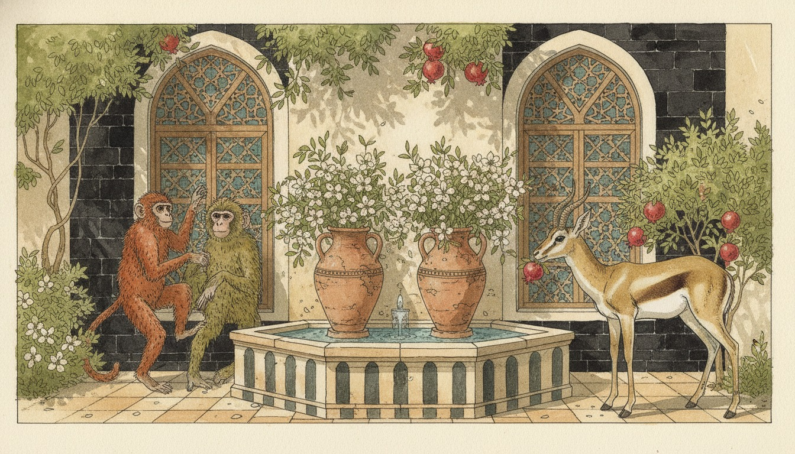
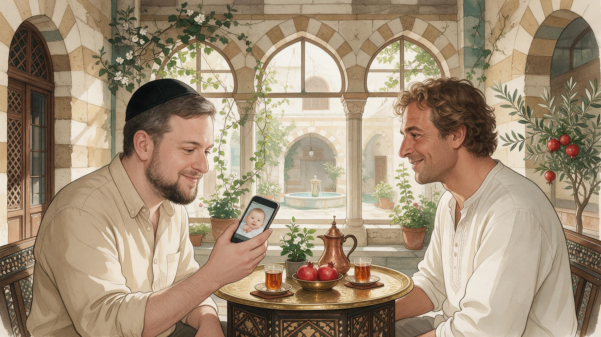

## خاطِرة

في مثل شامي بيضحّكني كتير: «القرد بعين أمّه غزال».

حرفيًا: القرد، بعيون أمّه، غزال. يعني مهما كان الولد بشع أو شقي، أمّه بتشوفه أحلى ولد بالدنيا.



بس المثل مش بس عن الإمّهات. منقوله عن أي حدا بيحبّ إشي تبعه وما بيشوف عيوبه. واحد بيفرجيك صور ابنه ميّة مرّة، أو بيقرالك قصيدة كتبها وهو متأكّد إنها أحسن قصيدة بالعالم.

وبصراحة؟ أنا كمان هيك مع ابني.

### أمثلة

{}



{}



## كلام

| Arabic | IPA | Meaning |
| ------ | --- | ------- |
| قرد | /ʔird/ | monkey (ق is a glottal stop in city Shami) |
| بعين | /bʕeːn/ | in the eye of (also بعيون, «in the eyes of») |
| غزال | /ɣaˈzaːl/ | gazelle; also a compliment for a beautiful person |
| أحلى ولد بالدنيا | /ˈʔaħla ˈwalad bidˈdinja/ | the cutest kid in the world |

---

*I post something short here most days while learning Arabic. If this helped, you'll probably like the next one too.*

