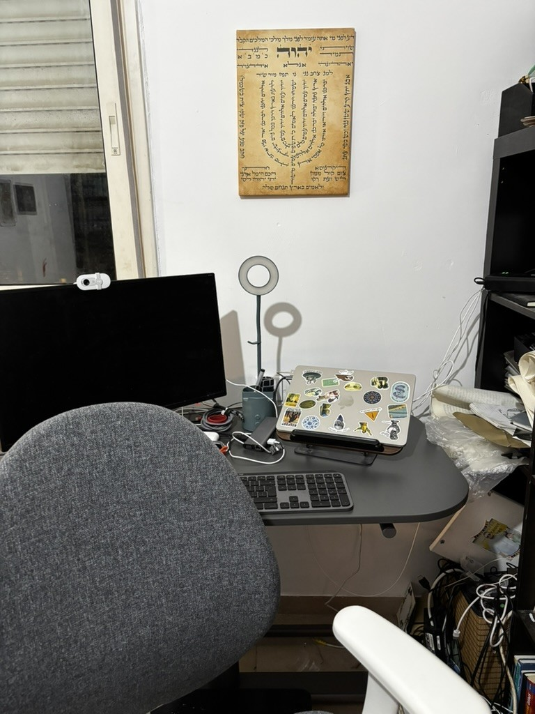

## خاطِرة

تحديث عن آخر بوست إلي

ركّبت الطاولة والكرسي بمكتبي.

لسّه ما خلصت تنظيف الغرفة، بس بلّشت.

هالطاولة الجديدة حلوة كتير.

بقدر أستعملها وأنا قاعد أو واقف.

وهلأ ما ضل عندي حجة عشان أأجّل الشغل!



## كلام

| Arabic                          | IPA                                                | Meaning                                                             |
| ------------------------------- | -------------------------------------------------- | ------------------------------------------------------------------- |
| ركّبت الطاولة                    | /ˈrakkabt etˤˈtˤaːwle/                             | I put the desk together (ركّب = «to assemble, install»)              |
| لسّه ما خلصت                     | /ˈlessa ma ˈxlesˤt/                                | I haven't finished yet (لسّه + past negative = «not yet»)            |
| بلّشت                            | /ˈballaʃt/                                         | I've started (بلّش = Shami for «to begin»)                           |
| بقدر أستعملها وأنا قاعد أو واقف    | /ˈbaʔder ʔesˈtaʕmelha w ˈʔana ˈʔaːʕed ʔaw ˈwaːʔef/ | I can use it sitting or standing (وأنا + participle = «while I'm…») |
| ما ضل عندي حجة                   | /ma dˤall ˈʕendi ˈħeʒʒe/                           | I have no excuse left (ضلّ = «to remain»)                            |

---

*I post something short here most days while learning Arabic. If this helped, you'll probably like the next one too.*

