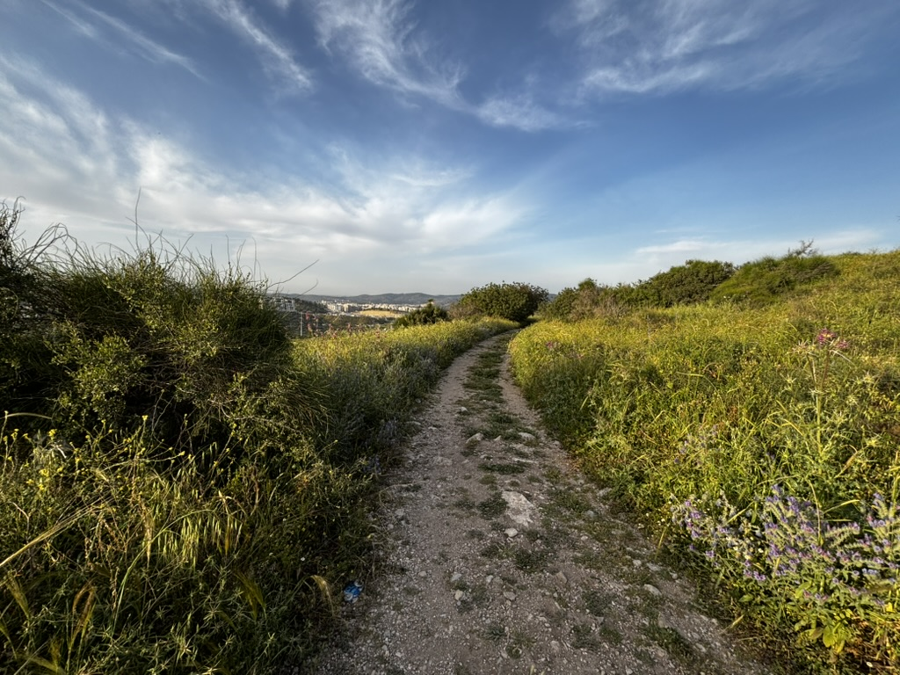
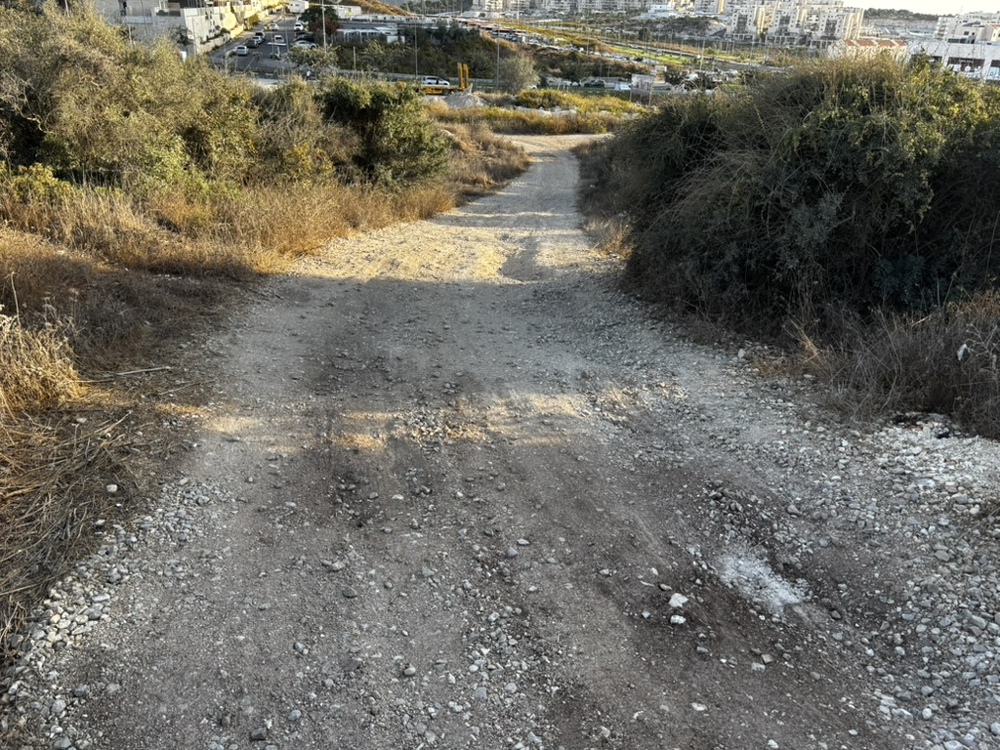
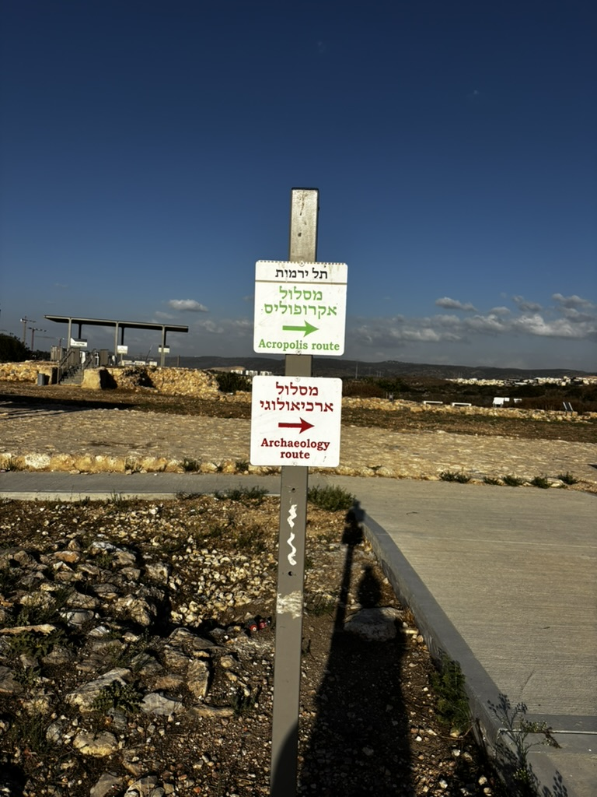
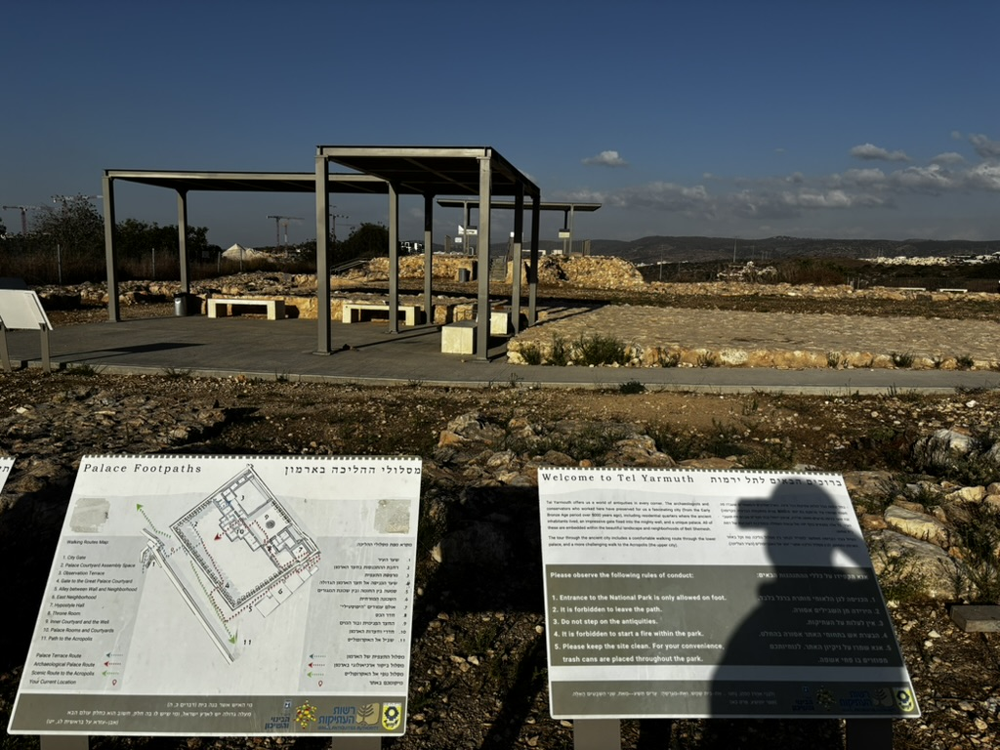
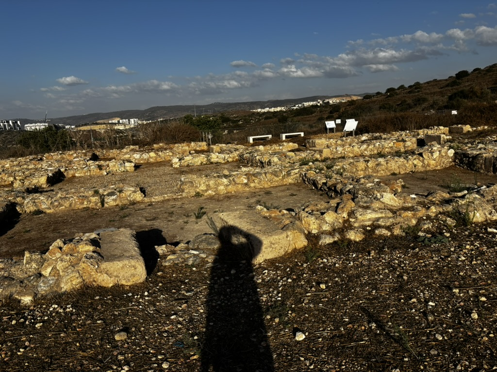
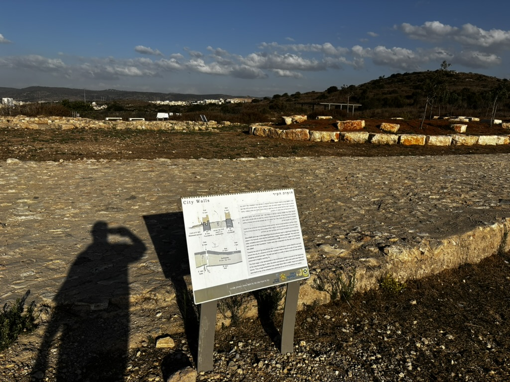
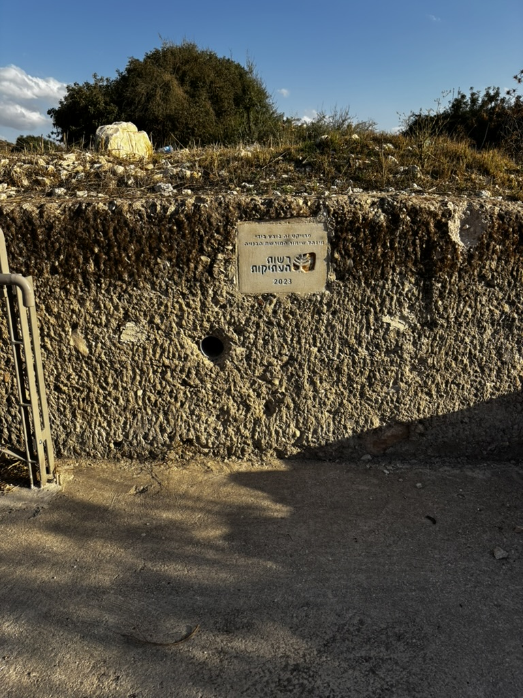
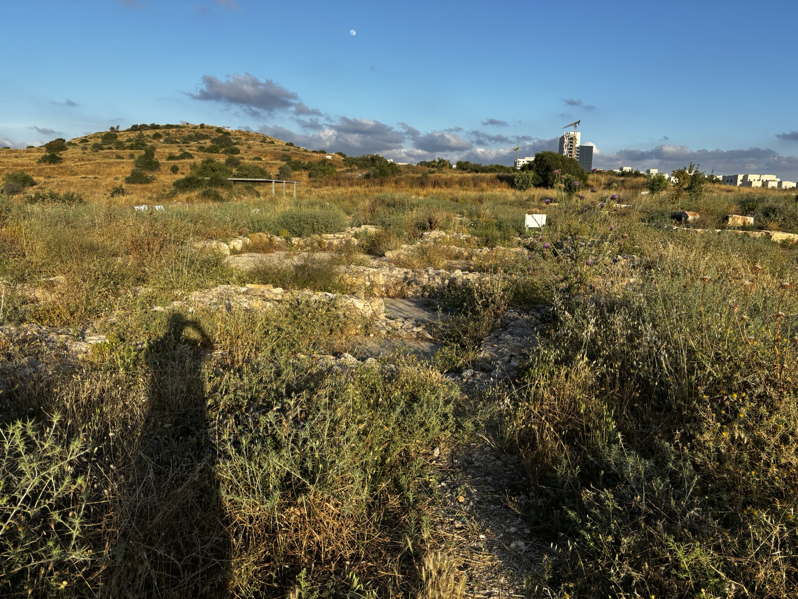
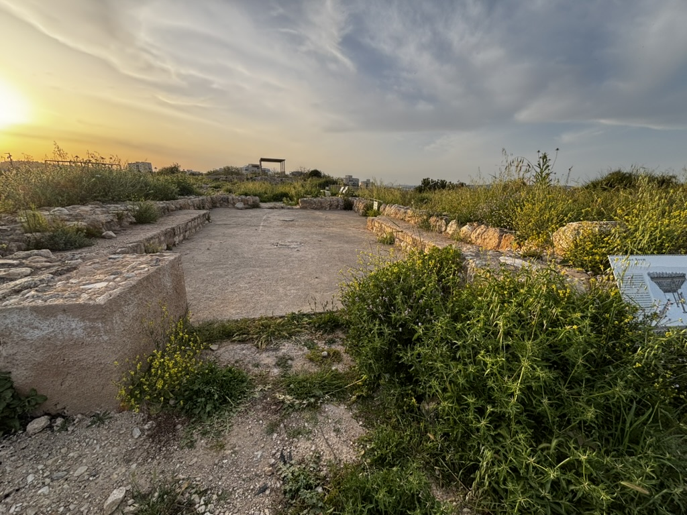
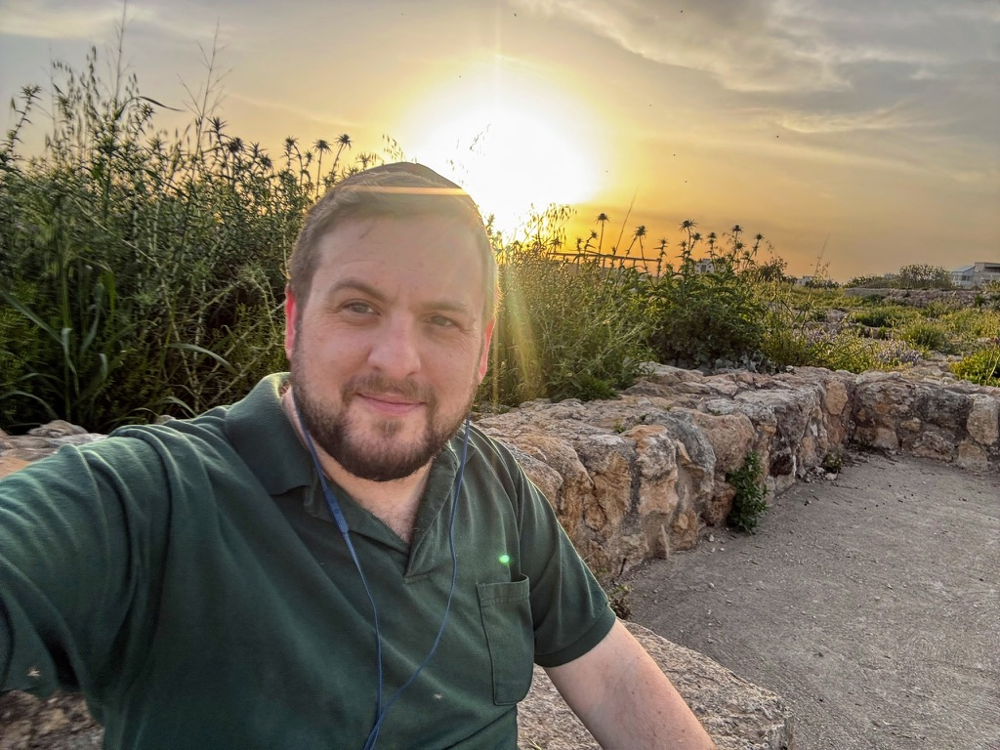

## خاطِرة

في مكان معيّن بحب أروح عليه لما بدي أروّق وأفكّر شوي.

اسم هالمكان تلّ يارموت.

فيه آثار قلعة أموريّة قديمة، وفيه مطلّ عالي كتير. بحب أتمشّى هناك.

هي منطقة هادية، وبالعادة ما فيها ولا حدا.

## صور







## كلام

| Arabic          | IPA                       | Meaning                                                           |
| --------------- | ------------------------- | ----------------------------------------------------------------- |
| بحب أروح عليه   | /bħebb ˈʔruːħ ʕaˈleːh/    | I like to go there (راح على = «to go to» a place)                  |
| لما بدي أروّق   | /ˈlamma ˈbeddi ʔaˈrawweʔ/ | when I want to unwind (روّق = «to calm down, clear your head»)    |
| أفكّر شوي       | /ʔaˈfakker ʃwaj/          | think a bit (شوي softens it: «a little»)                          |
| مطلّ عالي كتير  | /maˈtˤall ˈʕaːli ktiːr/   | a very high lookout (مطلّ from طلّ «to look out over»)             |
| بحب أتمشّى      | /bħebb ʔatˈmaʃʃa/         | I like to stroll (تمشّى = walk for pleasure, not to get somewhere) |
| ما فيها ولا حدا | /ma ˈfiːha wala ˈħada/    | there's nobody there at all (ولا + noun = «not a single»)          |

---

*I post something short here most days while learning Arabic. If this helped, you'll probably like the next one too.*

