## خاطِرة

اليوم كان آخر يوم بالعطلة لابني الكبير، وبكرا برجع يدرس باليشيفا.

عشان هيك رحنا نمشي بالطبيعة مع بعض.

بلشنا من وادي السنط، المكان اللي جالوت حارب فيه داود.

وبعدين مشينا لخربة قيافة، وهي بقايا مدينة قديمة كتير، ممكن تكون المدينة اللي اسمها شعرايم بالتناخ.

انبسطنا كتير بهالرحلة، بس طلعنا متأخر شوية.

لما رجعنا، كانت الدنيا عتمت، وكان صعب نلاقي السيارة.

خفت شوي، بس أخرنا خير, انبسطت كتير.

## صور


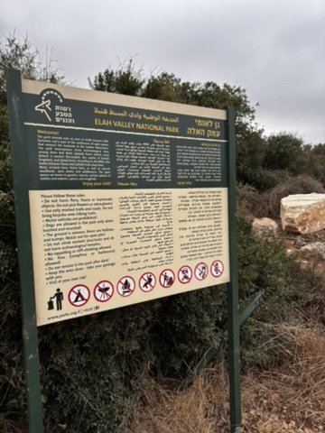
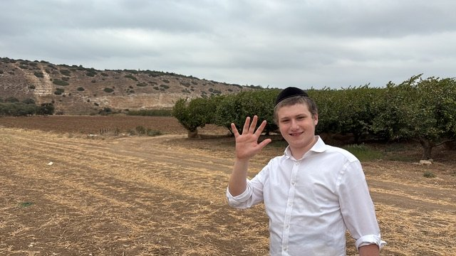
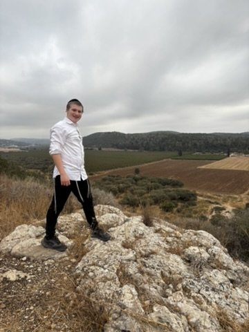
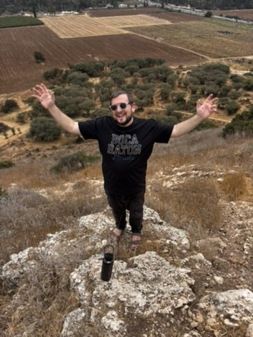
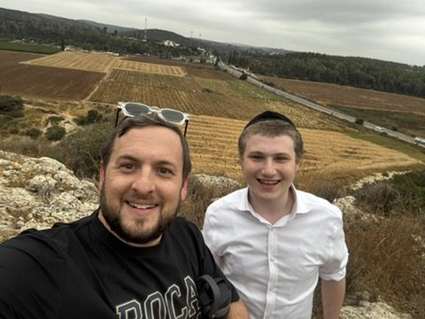
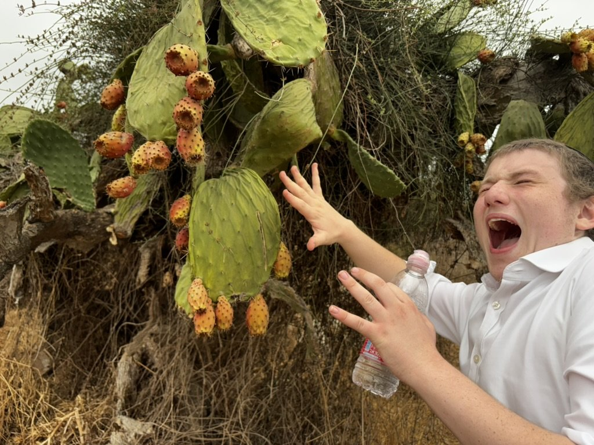
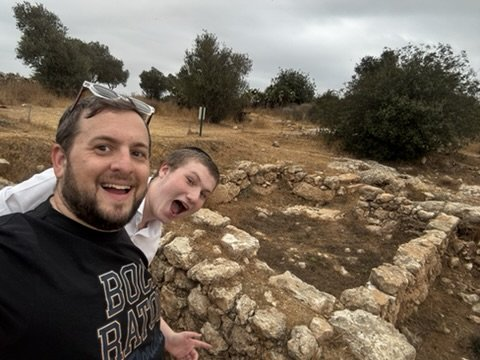
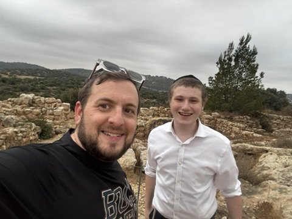
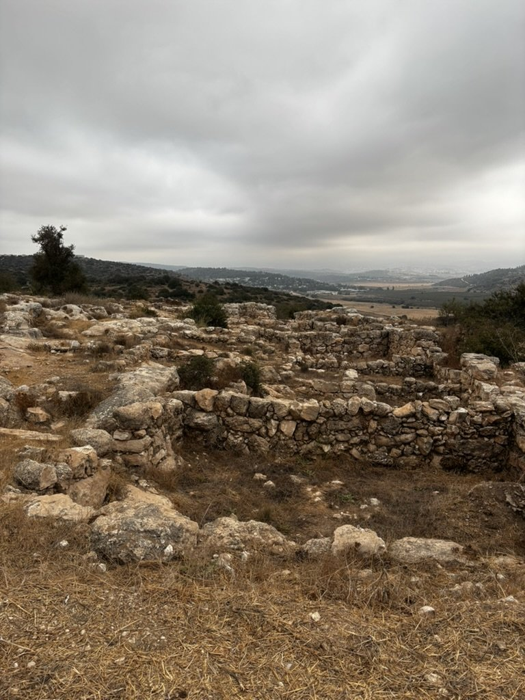
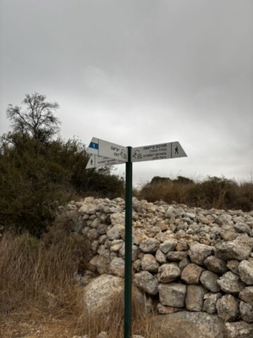
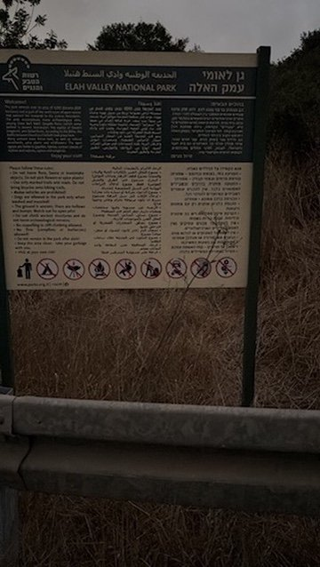




## كلام

| Arabic | IPA | Meaning |
| ------ | --- | ------- |
| عشان هيك | /ʕaˈʃaːn heːk/ | that’s why; for that reason |
| بقايا مدينة قديمة | /baˈʔaːja maˈdiːne ʔaˈdiːme/ | the remains of an ancient city |
| طلعنا متأخر | /tˤˈliʕna mitˈʔaxxir/ | we set off late |
| كانت الدنيا عتمت | /ˈkaːnit idˈdinja ˈʕatmit/ | it had already got dark |

---

*I post something short here most days while learning Arabic. If this helped, you'll probably like the next one too.*

